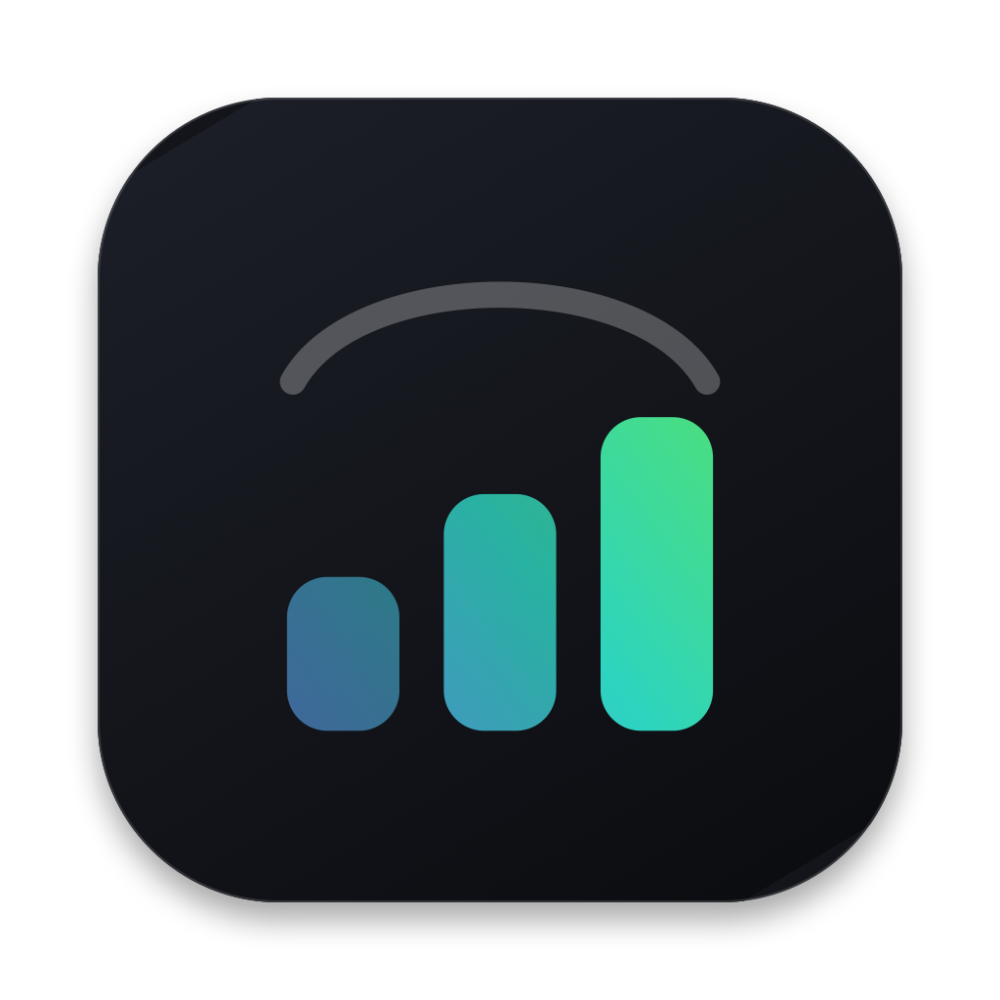

<div align="center">
  
  <h1>Toki</h1>
  <p><strong>A lightweight, pure native Swift macOS menu bar dashboard for local AI coding token usage.</strong></p>
  <p>
    <a href="https://wwzhuang01.github.io/toki/"><strong>Homepage</strong></a> ·
    <a href="README.zh-CN.md">简体中文</a> ·
    <a href="#features">Features</a> ·
    <a href="#supported-tools">Supported Tools</a> ·
    <a href="#installation">Installation</a> ·
    <a href="#configuration">Configuration</a> ·
    <a href="#build-from-source">Build from Source</a>
  </p>
  <p>
    
    
    
    
  </p>
</div>

---

**Toki** (*Token* + Japanese *時 / Toki*, meaning *time / moment*) sits quietly in your macOS menu bar and shows how many AI tokens you have used today at a glance — with zero accounts, zero logins, and zero Electron/Node overhead.

<!-- Screenshot placeholder: add a clean screenshot at docs/screenshot.png
<div align="center">
  
</div>
-->

## Features

- **Menu Bar at a Glance**: Live integer-compact today token readout (`329M`) paired with a crisp monochrome template icon that adapts to Light and Dark menu bars. Choose between compact, labeled (`Today 329M`), or cost (`329M · $129.65`) formats.
- **Rich Native Popover**: Click to inspect **Today / 7 Days / 30 Days** summaries, 4-channel token breakdown (`Uncached input`, `Cache read`, `Cache write`, `Output` + `Reasoning`), **Swift Charts** hourly/daily trend chart with hover readout, **By Provider**, and **By Model** rankings.
- **Estimated Cost & Cache Savings**: Automatically caches the public LiteLLM rate table (24h TTL) to estimate spend and prompt-cache savings in **USD** or **CNY** (with custom exchange rate and per-model price overrides).
- **Fast & Event-Driven**: Incremental scan cache (`size`, `mtime`, `byteOffset`) + `FSEvents` directory watching + automatic local midnight reset + sleep/wake refresh.
- **Pure Native & Tiny**: 100% Swift 6 + SwiftUI + AppKit + Swift Charts Universal Binary (`arm64` + `x86_64`), zero bundled Node.js runtime, auto-dismisses on outside click or `Esc`, supports Launch at Login (`SMAppService`), and bilingual **English / 简体中文** UI.

## Supported Tools

Toki requires **no login or API keys**. It reads local usage history directly from standard tool directories:

| Tool | Local Source | Notes |
| :--- | :--- | :--- |
| **Claude Code** | `~/.claude/projects` (`CLAUDE_CONFIG_DIR`) | Deduplicates streamed message blocks (`messageId:requestId`), tracks `advisor_message` calls & 1h cache writes, supports `.jsonl` and `.jsonl.zst` |
| **Codex** | `~/.codex/sessions` (`CODEX_HOME`) | Handles cumulative diffs, baseline rebases, pending-gap reconciliation, fork suppression, and cross-file dedupe |
| **Antigravity** | `~/.gemini/antigravity*`, `~/.config/antigravity` | Native SQLite3 + pure Swift Protobuf decoder with dynamic model-name learning |
| **OpenCode** | `~/.local/share/opencode` (`OPENCODE_DATA_DIR`, `XDG_DATA_HOME`) | Incremental SQLite3 `rowid` scanning across v1/v2 schemas + JSON fallback |

## 100% Local & Privacy-First

- **Read-Only Local Access**: Toki never modifies your AI tools' directories, databases, or transcripts.
- **No Telemetry, No Uploads**: Your prompts, code, and conversation history never leave your Mac.
- **Single Optional Network Call**: The only outbound request downloads the public [LiteLLM model pricing JSON](https://raw.githubusercontent.com/BerriAI/litellm/main/model_prices_and_context_window.json) once every 24 hours to estimate USD/CNY costs.
- **Isolated Cache**: Incremental scan cache and cached rate table are stored strictly inside `~/Library/Caches/io.github.wwzhuang01.toki/`.

## Installation

1. Download the latest Universal `Toki-*-universal.dmg` from [GitHub Releases](https://github.com/wwzhuang01/toki/releases/latest).
2. Open the `.dmg` and drag **Toki.app** into **Applications**.
3. **First-time Gatekeeper note**: Releases built without an Apple Developer ID certificate are ad-hoc signed. If macOS says *"Toki cannot be opened"* or *"is damaged"*, run once in Terminal:

```sh
xattr -dr com.apple.quarantine /Applications/Toki.app
```

Then launch **Toki** from Spotlight or `/Applications`.

## Configuration

Toki works out of the box with zero configuration. For advanced customization, create `~/.config/toki/config.json` (or set `TOKI_CONFIG_PATH` / `XDG_CONFIG_HOME`):

```json
{
  "modelAliases": {
    "my-proxy/claude-sonnet": "claude-sonnet-4-6"
  },
  "modelFilter": {
    "exclude": [
      { "model": "test-model" }
    ]
  },
  "priceOverrides": {
    "my-custom-model": {
      "inputCostPerMillionTokens": 3.0,
      "outputCostPerMillionTokens": 15.0,
      "cacheReadCostPerMillionTokens": 0.3,
      "cacheWriteCostPerMillionTokens": 3.75
    }
  },
  "sources": {
    "claude": ["~/work/.claude"],
    "codex": ["~/work/.codex"],
    "antigravity": ["~/work/antigravity"],
    "opencode": ["~/work/opencode"]
  }
}
```

- **T3 Code Compatibility**: If `~/.t3/userdata/settings.json` exists, Toki reads compatible `providerInstances`, `usageModelAliases`, `usageModelFilter`, and `usagePriceOverrides` read-only. Values in `~/.config/toki/config.json` take precedence when both are present.

## Build from Source

Requires **macOS 14+** and **Swift 6** (Xcode 16+ / Swift 6 toolchain).

```sh
# Run unit tests
swift test

# Build release binary
swift build -c release

# Inspect usage from the CLI (JSON to stdout; supports --days 1 | 7 | 30)
.build/release/Toki --dump-json --days 7

# Package Universal Binary (arm64 + x86_64) .app and .dmg
./scripts/package-app.sh
./scripts/package-dmg.sh
```

Useful build environment variables:
- `TOKI_ARCHS="arm64"` — build single-arch locally for faster iteration (defaults to `"arm64 x86_64"`).
- `TOKI_BUNDLE_ID="io.github.yourname.toki"` — customize `CFBundleIdentifier`.
- `TOKI_ZSTD_ARCHIVE=/path/to/zstd-1.5.7.tar.gz` — offline packaging with a pre-downloaded checksum-verified zstd archive.
- `TOKI_DATA_HOME=/path/to/home` — run `--dump-json` against a fixture home directory.

## Roadmap

- [ ] Apple Developer ID signing & notarization
- [ ] Homebrew Cask (`brew install --cask toki`)
- [ ] Sparkle in-app auto-updates
- [ ] Daily token / budget threshold alerts
- [ ] macOS Desktop Widgets (`WidgetKit`)

## Acknowledgements

- [T3 Code](https://github.com/pingdotgg/t3code) — inspiration for local multi-provider usage accounting semantics and configuration compatibility.
- [Magpie](https://github.com/yetone/magpie) — inspiration for the interactive stacked trend chart (`Tokens / Cost / Requests`) and hover breakdown tooltip UX.
- [LiteLLM](https://github.com/BerriAI/litellm) — public model pricing table (`model_prices_and_context_window.json`) used for cost and cache-savings estimation.
- [zstd](https://github.com/facebook/zstd) — fast decompression library bundled for reading `.jsonl.zst` archives (BSD-3-Clause license included in the app bundle).

## Disclaimer

Toki is an independent, unofficial open-source project and is not affiliated with, endorsed by, or sponsored by Anthropic, OpenAI, Google, or OpenCode. All product names and trademarks belong to their respective owners.

## License

[MIT](LICENSE)
