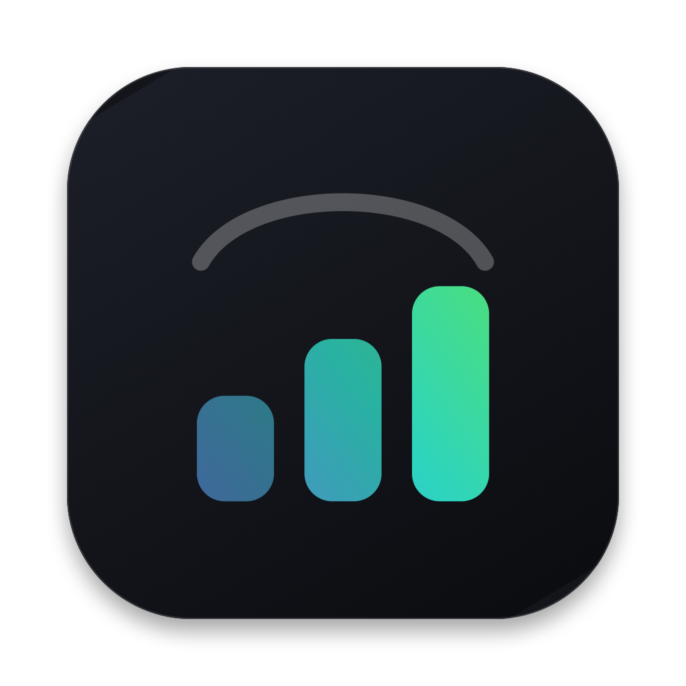

<div align="center">
  
  <h1>Toki</h1>
  <p><strong>轻量、100% 纯原生 Swift 打造的 macOS 菜单栏本地 AI Token 用量仪表盘</strong></p>
  <p>
    <a href="https://wwzhuang01.github.io/toki/"><strong>项目主页</strong></a> ·
    <a href="README.md">English</a> ·
    <a href="#功能亮点">功能亮点</a> ·
    <a href="#支持的工具">支持的工具</a> ·
    <a href="#安装方式">安装方式</a> ·
    <a href="#独立配置">独立配置</a> ·
    <a href="#从源码构建">从源码构建</a>
  </p>
  <p>
    
    
    
    
  </p>
</div>

---

**Toki**（取 *Token* 与日语「時 / Toki · 此刻」双关）常驻在 macOS 顶部菜单栏，抬眼即可看到今日 AI Token 消耗——**免登录、纯本地、零 Electron/Node 负担**。

<!-- 截图预留位：可将干净的 Toki 弹窗截图放置于 docs/screenshot.png
<div align="center">
  
</div>
-->

## 功能亮点

- **菜单栏一眼可见**：极简单色矢量图标（自动适配浅色/深色菜单栏）搭配整数化紧凑数字（如 `329M`），支持在偏好设置中切换「紧凑 / 带前缀 / 带费用」显示格式。
- **原生明细弹窗**：点击展开 **今日 / 7 天 / 30 天** 统计，包含四维 Token 拆分（未缓存输入、缓存读取、缓存写入、输出/推理）、支持悬停查看具体数值的 **Swift Charts** 趋势图、按服务商占比、按模型明细。
- **费用估算与缓存节省**：自动拉取并缓存公开的 LiteLLM 模型价格表（24h 刷新），支持 **USD / CNY** 切换、自定义汇率与单模型自定义价格覆盖。
- **极速增量刷新**：本地增量扫描缓存 + `FSEvents` 目录变动监听 + 本地时区跨午夜自动归零 + 睡眠唤醒即时刷新。
- **极致轻量与原生体验**：100% 纯原生 Swift 6 + SwiftUI + AppKit + Swift Charts（Apple Silicon & Intel 双架构通用包），点击外部区域或按 `Esc` 自动收起，支持开机自启与中英文双语界面。

## 支持的工具

**无需登录任何账号，也无需填写 API Key**，Toki 直接只读扫描本机默认日志与数据库目录：

| 工具 | 本地数据路径 | 解析说明 |
| :--- | :--- | :--- |
| **Claude Code** | `~/.claude/projects`（支持 `CLAUDE_CONFIG_DIR`） | 按 `messageId:requestId` 流式去重，计入 `advisor_message` 与 1h 缓存写入，支持 `.jsonl` 与 `.jsonl.zst` |
| **Codex** | `~/.codex/sessions`（支持 `CODEX_HOME`） | 支持累计快照差分、基线重置、中断间隙补齐、Fork 过滤与跨文件去重 |
| **Antigravity** | `~/.gemini/antigravity*`、`~/.config/antigravity` | 原生 SQLite3 + 纯 Swift Protobuf 解码，支持模型名动态学习 |
| **OpenCode** | `~/.local/share/opencode`（支持 `OPENCODE_DATA_DIR` / `XDG_DATA_HOME`） | 基于 `rowid` 的 SQLite3 增量扫描，兼容 v1/v2 表结构与 JSON 历史 |

## 100% 本地隐私保障

- **只读访问**：绝不写入或修改任何 AI 工具的数据目录与会话记录。
- **零遥测、零上传**：你的提示词、代码与对话内容完全留在本地。
- **唯一可选网络请求**：每 24 小时请求一次公开的 [LiteLLM 价格表](https://raw.githubusercontent.com/BerriAI/litellm/main/model_prices_and_context_window.json) 用于估算费用（离线时自动使用本地缓存）。
- **独立缓存目录**：所有增量缓存与费率缓存仅保存在 `~/Library/Caches/io.github.wwzhuang01.toki/`。

## 安装方式

1. 前往 [GitHub Releases](https://github.com/wwzhuang01/toki/releases/latest) 下载最新的通用安装包 `Toki-*-universal.dmg`（同时支持 Apple Silicon 与 Intel Mac）。
2. 双击打开 `.dmg`，将 **Toki.app** 拖入 `Applications`（应用程序）目录。
3. **首次打开解除 Gatekeeper 拦截**：由于开源版本暂未购买 Apple Developer ID 公证，首次打开若提示「无法验证开发者」或「已损坏」，请在终端执行一次：

```sh
xattr -dr com.apple.quarantine /Applications/Toki.app
```

随后从启动台 / Spotlight 打开 **Toki** 即可。

## 独立配置

Toki 默认零配置开箱即用。如需自定义数据源路径、模型别名、过滤规则或覆盖单价，可创建 `~/.config/toki/config.json`（也支持通过 `TOKI_CONFIG_PATH` 或 `XDG_CONFIG_HOME` 指定）：

```json
{
  "modelAliases": {
    "my-proxy/claude-sonnet": "claude-sonnet-4-6"
  },
  "modelFilter": {
    "exclude": [
      { "model": "test-model" }
    ]
  },
  "priceOverrides": {
    "my-custom-model": {
      "inputCostPerMillionTokens": 3.0,
      "outputCostPerMillionTokens": 15.0,
      "cacheReadCostPerMillionTokens": 0.3,
      "cacheWriteCostPerMillionTokens": 3.75
    }
  },
  "sources": {
    "claude": ["~/work/.claude"],
    "codex": ["~/work/.codex"],
    "antigravity": ["~/work/antigravity"],
    "opencode": ["~/work/opencode"]
  }
}
```

- **兼容 T3 Code 配置**：如果本机存在 `~/.t3/userdata/settings.json`，Toki 会自动只读兼容其中的 `providerInstances`、`usageModelAliases`、`usageModelFilter` 和 `usagePriceOverrides`；同名配置项以 `~/.config/toki/config.json` 优先。

## 从源码构建

需要 **macOS 14+** 与 **Swift 6**（Xcode 16+）。

```sh
# 运行单元测试
swift test

# 编译 Release 版本
swift build -c release

# CLI 模式输出 JSON（支持 --days 1 | 7 | 30）
.build/release/Toki --dump-json --days 7

# 打包 Apple Silicon + Intel 通用 .app 与 .dmg
./scripts/package-app.sh
./scripts/package-dmg.sh
```

常用构建环境变量：
- `TOKI_ARCHS="arm64"`：本地开发仅编单架构以加快构建速度（默认 `"arm64 x86_64"`）。
- `TOKI_BUNDLE_ID="io.github.yourname.toki"`：自定义 Bundle Identifier。
- `TOKI_ZSTD_ARCHIVE=/path/to/zstd-1.5.7.tar.gz`：离线打包时指定本地 zstd 源码包。
- `TOKI_DATA_HOME=/path/to/home`：命令行 `--dump-json` 指定自定义模拟主目录。

## Roadmap

- [ ] Apple Developer ID 签名与公证
- [ ] Homebrew Cask（`brew install --cask toki`）
- [ ] Sparkle 应用内自动更新
- [ ] 每日 Token / 费用上限提醒
- [ ] macOS 桌面小组件（`WidgetKit`）

## 致谢

- [T3 Code](https://github.com/pingdotgg/t3code)：感谢其在多服务商本地用量统计口径与配置兼容性上的参考与启发。
- [Magpie](https://github.com/yetone/magpie)：感谢其在趋势图交互（`Token / 费用 / 请求` 切换与柱状图悬停浮层明细卡片）上的设计灵感。
- [LiteLLM](https://github.com/BerriAI/litellm)：提供公开的模型价格表（`model_prices_and_context_window.json`），用于费用与缓存节省估算。
- [zstd](https://github.com/facebook/zstd)：提供 `.jsonl.zst` 归档解压能力（BSD-3-Clause 协议，完整协议文件随应用包一同分发）。

## 免责声明

Toki 是独立的开源项目，与 Anthropic、OpenAI、Google、OpenCode 等官方无隶属、背书或赞助关系。文中提及的所有产品名称与商标均归各自所有者所有。

## 开源协议

[MIT](LICENSE)
